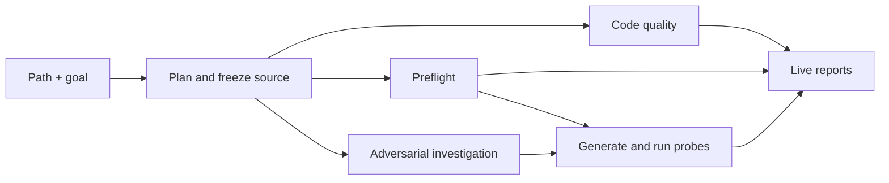

# Adversarial review agent

Review a working tree, file, folder, commit, branch, or repository with a path and a plain-English goal.
The agent combines focused code-quality analysis with executable adversarial testing.

## Architecture



The request defines the scope. The runner freezes each revision once, then starts code quality,
preflight, and adversarial investigation in parallel. Investigation only reads the frozen source.
Probe generation waits for both investigation and preflight so it can use the final diagnostics and
any prepared dependencies. Task reports are published as each task finishes.

- **Code quality** finds duplicated concepts and strings, hardcoded constants, missed reuse, and mixed responsibilities.
- **Preflight** inspects the application and prepares missing Node dependencies when allowed.
- **Adversarial** investigates the source while preflight runs, then generates and runs isolated probes on both revisions.
- **Reporting** publishes one report per task and a combined overview.

Preflight is advisory: adversarial testing is still attempted when setup cannot be fully verified.

## Skills and tasks

Skills define judgment and evidence rules. Prompts add the current scope. Tasks control validation,
execution, isolation, and reporting. Every review task loads its runtime skill automatically.

Add another first-class task with the project skill:

```text
$review-agent-add-task Add a performance task that reproduces event-loop stalls.
```

## Usage

Requires Node.js 24+, Git, and an installed, signed-in Codex or Cosine CLI.

```sh
npm ci
npm link
```

```sh
review-agent /path/to/app "Review my uncommitted changes and focus on authorization"
review-agent . "Review the src folder for duplicated constants; code quality only"
review-agent . "Review commit abc123 and try to break its input validation"
review-agent . "Review the main branch with two probes per hypothesis"
```

Quote paths containing spaces. With only a path, the CLI asks for a goal; pressing Enter reviews current
uncommitted changes against `HEAD`.

## Configuration

Shared agent settings live at the root and task controls live under `tasks`. See the
[configuration reference](CONFIGURATION.md) for every option, its limits, precedence, and examples.

## Results

Each invocation writes a live overview and one evidence-backed report per task under the reviewed project.
Exit codes: **0** completed; **1** reproduced regression; **2** incomplete or execution error.

## Development

```sh
npm run check
npm run demo
```

The demo exercises the pipeline offline without model calls.
