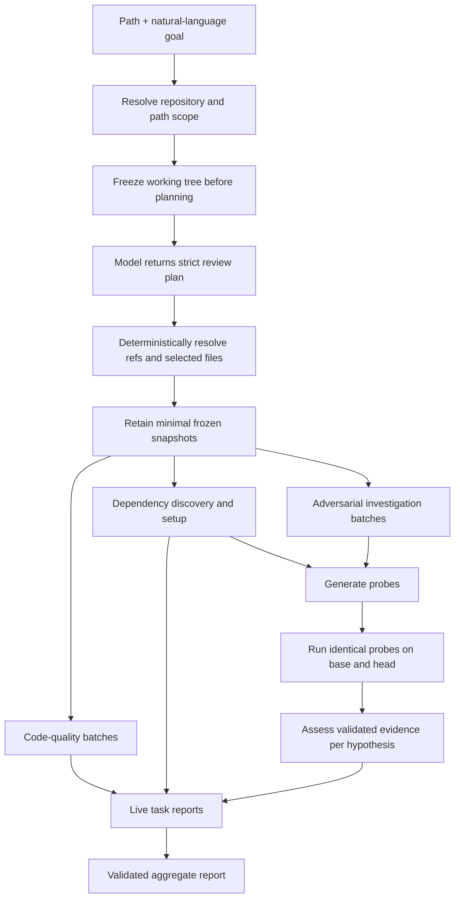

# Review Agent Reproduction Plan

This document is a build specification for reproducing the review-agent service with another coding agent. It records the intended behavior, architectural decisions, module boundaries, validation rules, and implementation order. Reproduce the behavior and invariants first; exact internal names can change when a clearer implementation preserves the same contract.

Reference implementation: the local project inspected on 13 October 2026. This document is self-contained: the rebuilding agent should not need the original repository. Implement the defined contracts and acceptance cases in a fresh project. Provider flags and model workarounds below describe this implementation; verify them against the installed CLI before live use. They are not claims about every future provider version.

The current product reviews local Git source. It does not fetch PR URLs, create GitHub review comments, run a web service, or guarantee exhaustive security or memory-leak detection. Those are separate extensions. The section on boundaries below identifies implementation limitations so a rebuild does not accidentally promise more than this service provides.

## 1. Target outcome

Build a local-first Node.js CLI that reviews a Git working tree, file, directory, commit, branch, or whole repository from a path and a natural-language request.

The service has two analysis goals:

1. **Code quality:** thoroughly inspect selected source for duplicated domain concepts, repeated strings, hardcoded business or configuration constants, missed reuse, and mixed responsibilities.
2. **Adversarial testing:** inspect the application, form falsifiable failure hypotheses, generate executable probes, run the same probes against baseline and head source, and classify the observed behavior.

The service must also:

- prepare and check the application environment before probe execution;
- keep setup failures advisory so testing is still attempted;
- publish one live Markdown report per task plus a combined report;
- work through interchangeable coding-agent CLIs such as Codex and Cosine;
- run directly on the host or inside an existing deployment container;
- avoid creating nested Docker containers;
- preserve the reviewed repository and its Git checkout;
- reuse frozen source and temporary execution copies to limit time and disk usage.

The primary command should remain simple:

```sh
review-agent /path/to/project "review the src folder"
```

The first positional value identifies the project, directory, or file. The remaining prose defines what to review and how. Infrastructure settings such as provider, model, retries, and default limits belong in configuration or explicit flags.

## 2. Product decisions to preserve

### Natural language selects intent; deterministic code selects source

Use a model to interpret the user's intent into a strict review plan. Use deterministic Git and filesystem code to resolve commits, branches, paths, changed files, and complete source manifests.

The model may choose among allowed comparison types, analyses, focus paths, and bounded budgets. It must never invent a path or Git ref, directly enumerate trusted impacted files, switch branches, or mutate the checkout.

### Freeze source before model planning

Capture the current working tree before the planning model runs. This prevents edits made during planning or clarification from changing the review inputs. Reuse that capture when the request targets uncommitted or current source.

### Evidence outranks model assertions

The model proposes and explains. Deterministic code validates schemas, file receipts, citations, command shapes, budgets, and evidence relationships. A model claim alone cannot become a reproduced defect.

### Compare identical experiments

An adversarial regression requires a matching probe payload executed against both baseline and head. A baseline pass followed by a head violation is a reproduced regression. Violations on both revisions are pre-existing. Setup failures, timeouts, crashes without a valid behavioral observation, and unmatched evidence are inconclusive.

### Preflight prepares the environment but does not gate testing

Preflight discovers runtimes, dependencies, configuration, build steps, services, and an appropriate test boundary. It reuses the installed environment first and may install missing Node dependencies in a private setup copy when allowed.

Blocked or incomplete preflight results must be passed to adversarial testing as diagnostics. Adversarial testing still attempts a feasible module-level or application-level probe and reports the actual execution result.

### Separate task judgment from task mechanics

Runtime skills contain the task's review judgment and evidence guidance. TypeScript task modules own schemas, validation, concurrency, execution, source integrity, status, and reporting. Per-run prompts add the selected scope and data to the stable skill instructions.

Create four runtime `SKILL.md` files with YAML `name` and `description`: `dependency-preflight` for setup, `code-quality-review` for reuse and evidence rules, `adversarial-testing` for hypotheses/probes/assessment, and `review-report` for synthesis. Use an explicit task-to-skill mapping loaded relative to the installed application's module location, not the caller's cwd. Task prompts compose that skill with stage-specific schemas, the original user goal, source batches, and execution diagnostics. Providers return JSON and never own the task schedule. The project skill under `.agents/skills/review-agent-add-task/` is for development and is never loaded into runtime reviews.

### Parallelize independent work

Start code quality, preflight, and adversarial source investigation concurrently. Adversarial probe generation waits until both investigation and preflight finish because it needs the hypotheses and final setup diagnostics. Final reporting waits for every selected task.

Concurrency inside a task is separately bounded by configuration.

### Publish partial progress

After successful planning, initialize all task report files when review execution starts. Update a task's report atomically as its lifecycle changes. A user should be able to read completed code-quality results while adversarial probes continue. Configuration, target, capture, or planning failures can occur before report initialization; preserve whatever request artifacts exist and exit with an actionable error.

### Fail closed and preserve partial evidence

Exhausted model failures, incomplete applicable-source coverage, and inconclusive behavioral evidence make the affected analysis incomplete. Invalid quality candidates can be repaired or explicitly rejected while valid findings and examination receipts survive; rejecting an unsupported candidate does not automatically fail a fully examined batch. Never promote malformed output into a finding or erase completed sibling work.

## 3. Technology and runtime

Use:

- Node.js 24 or newer;
- TypeScript executed as ESM;
- Git through argument-array child processes;
- AJV for strict JSON Schema validation;
- `semver` for Node engine compatibility;
- the built-in Node test runner;
- no web framework and no database for the initial CLI service.

The process should run on the user's machine or inside the container where the service is already deployed. Child processes run directly in that environment with explicit timeouts, output limits, scratch directories, and minimal environment variables.

Use `"type": "module"`, `"engines": {"node": ">=24"}`, and `"bin": {"review-agent": "src/cli.ts"}` in the package manifest. The CLI needs a `#!/usr/bin/env node` shebang and executable permission. Use explicit `.ts` imports and `import type` for type-only imports. Node runs erasable TypeScript directly; avoid syntax requiring emitted runtime transforms such as constructor parameter properties. Typecheck with `target: ES2024`, `module: NodeNext`, `moduleResolution: NodeNext`, `allowImportingTsExtensions`, `noEmit`, `strict`, `noUncheckedIndexedAccess`, and `verbatimModuleSyntax`.

Define the scripts explicitly: `start` = `node src/cli.ts`; `test` = `node --test test/*.test.ts`; `test:runtime` = `node --test test/*.integration.ts`; `typecheck` = `tsc --noEmit`; `check` = `npm run typecheck && npm test`; `demo` = `node scripts/demo.ts`. Runtime dependencies are AJV 8 and semver 7; development dependencies are TypeScript 5.9 and Node 24/semver typings. Generate and retain a lockfile when scaffolding the new project.

## 4. User-facing behavior

### Accepted review targets

Support these comparisons:

| Request | Baseline | Head | Default scope |
| --- | --- | --- | --- |
| Uncommitted working tree | `HEAD` | Frozen staged, unstaged, deleted, renamed, mode-changed, and non-ignored untracked content | Changed paths |
| File or folder | `HEAD` | Frozen current source | All source under the supplied path unless the user asks for edits only |
| Commit | Explicit base or first parent | Requested commit | Changed paths |
| Branch with explicit base | Requested base | Requested branch | Changed paths |
| Branch without a base | Same pinned branch tree | Same pinned branch tree | All selected source; issues are existing behavior |
| Entire repository | `HEAD` | Frozen current source | All source |

Working-tree mode captures final on-disk bytes, including staged edits still present on disk; it is not a separate review of the index. Clarify staged-only requests. Compare explicit base/head refs directly, not through an implicit merge base. A root commit without a resolvable parent requires an explicit baseline. Refs must already exist locally. A clean working tree in default changes mode has no selected changes; it does not silently review previously committed code.

For `changes`, intersect deterministic changed paths with the path focus. For `all`, take the sorted union of exported base/head paths under focus, including unchanged source and deletions. Keep `changedFiles` and `reviewFiles` distinct in the report. The existing task context calls its selected-path array `changedFiles` even in full-source mode; preserve the meaning rather than relying on that misleading name.

Allow semantic requests such as “focus on authorization” without converting the topic into a fictional directory. The focus path remains empty unless the topic maps confidently to real repository paths.

If intent cannot be represented safely, return one concise clarification question. Permit a small bounded number of clarification rounds.

Path-only invocation asks for a description when both stdin and stdout are terminals; Enter uses uncommitted changes. Without a terminal, use that default immediately. Allow at most two clarification answers and reuse the same capture across retries. An unanswered or unrepresentable request exits with an error rather than silently widening scope. Preserve the complete user goal in every task prompt after planning.

### Path handling

Paths with spaces should work when quoted. Add a recovery mechanism for accidentally shell-split paths: find the longest existing prefix that resolves into a Git repository while preserving remaining arguments as review prose. Reject ambiguous cases where more than one valid target exists.

Support a tracked file deleted from the working tree by walking upward to an existing ancestor and resolving its repository-relative path.

### Exit codes

- `0`: review completed without a reproduced regression;
- `1`: review completed and reproduced at least one regression;
- `2`: review or execution remained incomplete.

Code-quality recommendations alone do not produce exit code `1`.

## 5. End-to-end architecture



Keep four layers distinct:

1. **Request layer:** path recovery, repository discovery, freezing, natural-language planning, clarification, and conversion to validated review options.
2. **Review layer:** snapshot preparation, task lifecycle, concurrency, dependency boundaries, status aggregation, and final reporting.
3. **Task layer:** task-specific prompts, schemas, validation, evidence rules, and result contracts.
4. **Runtime and bridge layer:** Git, source copies, process execution, retries, probes, CLI translation, provider billing, and model compatibility.

## 6. Recommended project structure

Use this shape as a guide:

```text
review-agent/
├── .agents/
│   └── skills/
│       └── review-agent-add-task/     Project skill for adding pipeline tasks
├── skills/                            Runtime judgment loaded by tasks
│   ├── dependency-preflight/
│   ├── code-quality-review/
│   ├── adversarial-testing/
│   └── review-report/
├── scripts/
│   └── demo.ts                        Offline pipeline demonstration
├── src/
│   ├── bridges/
│   │   ├── bridge.ts                  Stable bridge contract and registry
│   │   ├── cli.ts                     Shared subprocess bridge implementation
│   │   └── providers/
│   │       ├── index.ts               Built-in provider exports
│   │       ├── codex.ts
│   │       └── cosine/
│   │           ├── index.ts
│   │           ├── bridge.ts
│   │           ├── billing.ts
│   │           └── models/            Model-family workarounds and adaptations
│   ├── config/                         Types, defaults, schema, merging, CLI overrides
│   ├── request/                        Planner prompt/schema and target resolution
│   ├── review/                         Option validation, report creation, task lifecycle
│   ├── runtime/                        Git, snapshots, process runner, probes, source pool
│   ├── shared/                         Central types, schemas, limits, errors
│   ├── tasks/
│   │   ├── preflight/
│   │   ├── code-quality/
│   │   ├── adversarial/
│   │   ├── report/
│   │   ├── context.ts                 Task-bound skills and model invocation
│   │   ├── source-inventory.ts        Deterministic chunks and file manifests
│   │   └── validation.ts
│   ├── cli.ts
│   ├── command.ts
│   └── review.ts                      Top-level orchestrator
├── test/                               Unit, integration, concurrency, and fixture tests
├── review-agent.config.json
├── CONFIGURATION.md
├── README.md
└── package.json
```

Keep provider-specific model adaptations inside the provider's `models/` directory. The main bridge should express the provider protocol; billing detection and model quirks should remain separate.

## 7. Core contracts

Define central discriminated types before implementing tasks.

### Task vocabulary

- Tasks: `preflight`, `code-quality`, `adversarial`, `report`.
- User-selectable analyses: `code-quality`, `adversarial`.
- Agent stages: request planning, preflight, code-quality, investigation, generation, assessment, and report generation.
- Task lifecycle: pending, running, completed, incomplete, or skipped.

Preflight is selected whenever adversarial analysis is selected, and is skipped when the selected file set is empty. Reporting runs once review execution begins, including after analysis failure; failures before that boundary may have only request artifacts.

### Agent request

Every provider receives one stable request containing:

- task and stage;
- prompt;
- exact JSON Schema;
- task workspace with references to source that the agent must keep unchanged;
- artifact output directory;
- timeout and cancellation signal;
- progress callback.

Provider details must not appear in task code.

### Task results

Every task result includes:

- `status: completed | incomplete`;
- structured evidence or findings;
- errors;
- evaluated-file coverage where source is inspected.

The aggregate report includes resolved comparison metadata, review files, snapshots, task lifecycles, timings, storage statistics, task results, errors, and limitations.

### Coverage receipt

For each selected path, record:

- examined;
- skipped with a reason;
- unreported;
- whether the path is applicable source.

For code quality and adversarial source investigation, selected applicable source that is skipped or unreported makes the analysis incomplete. Preflight instead receipts the setup-related files it actually inspected from the complete application. Reporting consumes task results and explicitly states that it did not inspect source. Examination receipts are model reports, not instrumentation proving every line was understood or executed. The existing adversarial receipt is file-level; quality also requires chunk IDs.

### Model response contracts

Create a JSON Schema for each shape below. Every listed field is required, even when its array is empty or an allowed value is `null`; use `additionalProperties: false` for every structured object. Validate inside the shared invocation wrapper even for custom/fixture bridges. Use dynamic enums for selected paths, chunk IDs, hypothesis IDs, and available evidence IDs. Schema validity is followed by cross-field validation, never treated as proof of a finding.

| Shape | Required fields |
| --- | --- |
| ReviewPlan | `comparison: {kind: working-tree/commit/branch/repository, ref: string/null, baseRef: string/null}`, `reviewScope: changes/all`, `focus: string[]`, `analyses: (code-quality/adversarial)[]`, `installDependencies: boolean`, `maxHypotheses`, `maxExperimentsPerHypothesis`, `maxQualityFindings`, `perTaskConcurrency`, `agentTimeoutSeconds`, `testTimeoutSeconds`, `summary`, `clarification: string/null` |
| FileExamination | `examinedFiles: string[]`, `skippedFiles: {path, reason}[]` |
| PreflightDiscovery | FileExamination plus `approach`, `requirements: Prerequisite[]`, `notes: string[]` |
| Prerequisite | `id`, `category: runtime/package/build/configuration/service/startup`, `description`, `required: boolean`, `revisions: (base/head)[]`, `sources: {revision: base/head, path}[]`, `remediation`, `check: {parallelSafe: boolean, files: {path, content}[], argv: string[]}/null` |
| CodeQualityReview | FileExamination plus `findings: CodeQualityFinding[]`, `reviewedChunks: string[]`, `moreFindings: boolean`, `notes: string[]` |
| CodeQualityFinding | `id`, `title`, `category: duplication/duplicate-string/hardcoded-constant/reuse/responsibility`, `origin: introduced/pre_existing`, `severity: high/medium/low`, `explanation`, `recommendation`, `changedFiles: string[]`, `locations: {revision: base/head, path, line, snippet}[]` |
| Investigation | FileExamination plus `hypotheses: Hypothesis[]`, `notes: string[]` |
| Hypothesis | `id`, `title`, `severity: high/medium/low`, `claim`, `invariant`, `expectationSource`, `changedFiles: string[]`, `testIdea` |
| Generation | `experiments: Experiment[]`, `skipped: {hypothesisId, reason}[]` |
| Experiment | `id`, `hypothesisId`, `description`, `parallelSafe: boolean`, `files: {path, content}[]`, `argv: string[]` |
| Assessment | `findings: {hypothesisId, verdict: defect/unsupported/inconclusive, confidence: high/medium/low, explanation, expectationJustification, evidenceIds: string[]}[]` |
| ReportNarrative | `summary`, `priorities: {source: code-quality/adversarial, findingId, reason}[]`, `notes: string[]` |

Unannotated leaf fields in this table are nonempty strings, except budgets/timeouts and one-based source `line`, which are integers. IDs follow `^[a-zA-Z][a-zA-Z0-9_-]{0,63}$`; ordinary text is bounded to 12,000 characters. An assessment call concerns exactly one hypothesis and must cite each of its available execution IDs exactly once, including both revisions even when commits are identical. Generation must account for every hypothesis with one or more experiments OR one skip, never neither or both.

### Deterministic result contracts

Use `Snapshot {commit, directory, files: string[], excluded: {path, reason}[], sha256}` and `WorkingTreeCapture {base, head, changedFiles}`. A working-tree commit label is `working-tree:<sha256>`; it is never passed to Git as a ref. `AgentBridge` exposes `name`, optional `supportedSettings` and `billingRoute`, and `run(AgentRequest): Promise<unknown>`.

An `ExperimentExecutor` accepts `{experiment, snapshot, revision, payloadDirectory, artifacts, timeoutMs, signal?}` and returns execution evidence. `ProcessResult` records `{exitCode, signal, timedOut, aborted, outputLimited, durationMs, stdout, stderr}`. Each evidence record uses ID `<experimentId>:<revision>` and includes experiment/hypothesis IDs, revision, commit, original and resolved argv, payload SHA-256, executor name, runtime versions/platform, process result, parsed observation or null, outcome, and stdout/stderr paths. The shared probe runner verifies provenance and hashes before accepting it.

Task results extend `{status: completed/incomplete, errors: string[]}` with: preflight discovery/checks/setup/readiness; quality findings/coverage/notes/batch receipts; adversarial investigation/generation/evidence/findings/coverage; or report narrative. Findings use machine values `reproduced_regression`, `pre_existing`, `not_reproduced`, `inconclusive`. Initialize unavailable results to null or empty collections so deterministic reporting can still run after failures. A `version: 2` aggregate report retains those task results, original instructions, resolved scope, source inventories, task lifecycles, timings, storage statistics, errors, and limitations.

## 8. Configuration

Use a strict JSON configuration. Unknown keys must fail before any model call so typos cannot silently change a run.

Shared provider and runtime values live at the root. Task-specific controls live under `tasks`.

```json
{
  "cli": "cosine",
  "model": "lumen-scout",
  "billingProvider": "cosine",
  "structuredOutput": "auto",
  "speed": "fast",
  "reasoningEffort": "medium",
  "perTaskConcurrency": 3,
  "agentTimeoutSeconds": 300,
  "agentRetries": 1,
  "agentRetryDelaySeconds": 2,
  "tasks": {
    "preflight": {
      "installDependencies": true,
      "dependencySetupTimeoutSeconds": 300
    },
    "codeQuality": {
      "enabled": true,
      "maxFindingsPerBatch": 10,
      "maxBatches": 64
    },
    "adversarial": {
      "enabled": true,
      "maxHypotheses": 6,
      "maxInvestigationBatches": 64,
      "maxExperimentsPerHypothesis": 1,
      "probeTimeoutSeconds": 120,
      "assessmentConcurrency": 2,
      "assessmentRetries": 1,
      "probeRepairAttempts": 1,
      "assessmentTimeoutSeconds": 300
    }
  }
}
```

Precedence is:

1. explicit CLI overrides;
2. explicit config file;
3. bundled config;
4. application defaults.

Natural language may adjust review scope, enabled analyses, dependency installation, hypothesis and finding budgets, concurrency, and run-specific timeouts. Provider selection, billing route, retries, batch safety ceilings, and assessment policy remain configuration concerns.

Treat `enabled` as a planner default: an explicit request can select a different analysis set. Reject configurations disabling both analyses before planning. Merge partial nested task objects field-by-field so overriding a single budget retains its siblings. Convert configuration seconds to runtime milliseconds once when constructing review options.

Support flags `--config`, `--cli`, `--cli-path` (maps to `executable`), `--model`, `--speed`, `--reasoning-effort`, `--verbosity`, `--billing-provider`, `--structured-output`, repeatable `--bridge-module`, and `--help`/`-h`. `--` terminates flag parsing for prose that starts with a flag-like value. Executable paths and bridge modules from a file resolve relative to that file; CLI paths resolve from the current working directory. Bare executable names use PATH.

Optional bridge settings include `executable`, `verbosity: low/medium/high`, and `bridgeModules: string[]` (at most 10). Use `speed: standard/fast`, `structuredOutput: auto/native/prompt`, `billingProvider: cosine/openai`, and reasoning `none/minimal/low/medium/high/xhigh/max/ultra`. Model identifiers remain strings passed to the provider; a model name does not establish its billing account or price. Application fallback without a bundled config is Codex with its CLI model default; the JSON above is the reference bundled Cosine configuration.

Centralize these bounds and use them in config, plan schemas, and direct review-option validation:

| Setting | Allowed range |
| --- | --- |
| Per-task concurrency | 1–32 |
| Hypotheses; quality findings per batch | 1–20 each |
| Experiments per hypothesis | 1–3 |
| Quality/investigation batch ceilings | 1–256 |
| Assessment concurrency | 1–8 |
| Agent retries, assessment retries, probe repair attempts | 0–3 each |
| Retry delay | 0–30 seconds |
| Agent, probe, setup, assessment timeouts | 1–3600 seconds each |

Planning uses configured agent limits because no plan exists yet. Assessments use `min(agentTimeout, assessmentTimeout)`; preflight checks use `min(probeTimeout, 60 seconds)`; dependency installation uses its setup timeout. These are per-attempt ceilings, not an overall review deadline. `perTaskConcurrency` bounds work inside each task, not total service-wide model calls. Source batch fan-out is additionally capped at four per task; assessment uses its own concurrency setting.

Retry failed bridge/schema attempts at most `agentRetries` times after the initial attempt, with exponential delay capped at 30 seconds. Save each retry in its own directory plus an `attempts.json` record. Cancellation and integrity failures abort without retry. Assessment owns its separate per-hypothesis retry loop and disables the generic retry loop to avoid multiplied calls. A quality citation repair and a preflight check-repair are separate, bounded recovery stages.

Do not implicitly read configuration from the reviewed repository. Repository files are untrusted review input.

## 9. Request planning and deterministic scope

### Preparation

1. Resolve the repository and optional file/directory scope.
2. Allocate exactly one run directory under the target project's `reports/` directory; do not create a separate planning run.
3. Freeze the current `HEAD` tree and effective working-tree bytes.
4. Record the current branch as metadata.
5. Invoke the planner with repository metadata, real paths, configured defaults, supplied path scope, and the user's prose.

The planner must not read source or run tools. It returns a strict object containing:

- comparison kind and refs;
- `changes` or `all` scope;
- exact focus paths;
- selected analyses;
- dependency-install choice;
- bounded budgets and timeouts;
- summary or clarification.

### Plan validation

After schema validation:

- reject duplicate analyses;
- require repository and branch-without-base requests to use full selected source;
- resolve requested refs through Git without changing checkout;
- reject focus traversal, absolute paths, globs, unknown paths, and widening beyond the supplied path;
- require an explicit clarification when a commit/branch ref or baseline is missing;
- convert only validated values into review options.

This split is central: the planner interprets intent; deterministic code establishes the actual review set.

## 10. Frozen source and storage strategy

### Snapshot contents

Working-tree capture should include tracked and non-ignored untracked files and preserve executable mode. It should detect deletions and avoid Git clean filters, hooks, or text conversions.

Exclude or specially record:

- Git internals;
- agent configuration directories;
- credentials and environment files;
- installed dependencies;
- symlinks and symlink parents;
- submodules and special files;
- oversized captures.

The reference bounds are 5,000 files and 32 MiB of exported source per snapshot. Read Git blobs via NUL-delimited `ls-tree` metadata and `cat-file --batch`; preserve binary bytes and executable bits. Read working-tree files with no-follow checks, verify identity/size before and after reading, and ensure HEAD has not moved during capture. This detects per-file changes during capture; it is not an atomic filesystem snapshot of simultaneous edits across multiple files. Bound the diff to 250,000 bytes, report truncation, and retain complete exported source separately.

### Integrity

Hash sorted relative filenames, modes, lengths, and bytes. Verify frozen source and workspace references around task model attempts and execution leases. The planner receives metadata rather than source; captured inputs are revalidated when prepared for analysis. Reject results whose source or probe payload changed. These checks detect writes after the fact; they do not provide an operating-system sandbox or prevent writes elsewhere.

### Minimal retained copies

- Reuse the request-time freeze for working-tree and current-source reviews.
- Export committed snapshots only when a commit or branch request needs them.
- Deduplicate identical Git trees and identical source hashes.
- Give read-only tasks lightweight directory references to retained snapshots instead of new physical copies.
- Run all generated preflight/adversarial programs in private execution copies; the runner cannot assume arbitrary generated code is read-only. Dependency installation gets a separate mutable setup copy. Probe source and leased application source must still hash unchanged after execution; builds/caches go to scratch.
- Prefer filesystem copy-on-write/reflink behavior where available.
- Pool execution copies by source digest, verify them between leases, clear sibling files, and discard any copy changed by a failed operation.
- Remove temporary execution copies after analysis and report copy/reuse statistics.

## 11. Task orchestration

Create lifecycle entries for every task before analysis starts, and publish the initial overview immediately.

Run this dependency graph:

```text
code quality ----------------------------------------------------------> final report
preflight -------------------+
                             +-> probe generation -> execution -> assessment -> final report
adversarial investigation ---+
```

Use `Promise.allSettled` or equivalent semantics so one task failure does not abandon active siblings. Drain setup and running child work before reporting or cleaning shared workspaces.

The task runner owns:

- pending/running/terminal status;
- start, finish, and duration timestamps;
- progress events;
- serialized atomic report publication;
- error capture;
- failure isolation.

Determine overall completion from all selected analyses, source preparation, source-pool cleanup, and report generation. Preflight readiness/status is advisory: preserve its errors and report them, but an incomplete preflight alone does not force an incomplete overall review if the selected analyses and reporting succeed. Thus task status, readiness, finding verdict, and aggregate status are distinct fields. An incomplete overall review takes exit-code precedence over reproduced regressions.

## 12. Code-quality task

### Purpose

Review every selected source line for:

- repeated domain strings such as statuses, event names, endpoints, error messages, and storage keys;
- hardcoded business and configuration constants;
- duplicated validation, transformation, policy, or orchestration logic;
- missed reuse of existing shared definitions;
- modules that mix responsibilities which need to evolve independently.

Avoid generic style advice, formatting comments, speculative abstractions, and merging code that only looks similar.

### Deterministic inventory

Build a complete manifest from selected files. For text source:

- chunk large files at bounded character sizes without dropping lines;
- keep related path domains together where possible;
- represent unchanged identical base/head source once while recording equivalence;
- provide both revisions when contents differ;
- index repeated string candidates across related head source as hints;
- classify binary or unsupported text visibly.

Batches exist to bound context, not to sample files. A batch safety ceiling that omits source makes the task incomplete.

Reference inventory limits: 30,000 characters per source chunk; 60,000 characters per batch; a source line over 12,000 characters makes its file unsupported for this representation. Group root files separately, `src/lib/app/test/tests` by their next directory, and `packages/apps` by package; split a domain only when it exceeds the batch bound. Chunks carry ID, relative path, revision, original line range, content, and optional equivalent revision. Literal hints are bounded (10,000 values, 20 locations per value, 500 repeated candidates overall, 30 candidates per prompt) and are never evidence by themselves.

### Model output and validation

Each batch returns findings, examined files, reviewed chunk IDs, overflow indication, notes, and skipped files. Validate:

- every supplied chunk is acknowledged;
- file receipts use exact selected paths;
- finding IDs are unique;
- locations exist in frozen source;
- duplicate and duplicate-string claims cite at least two distinct `(path, line)` locations within one revision;
- wrong line numbers may be repaired only from a unique exact source quote;
- unsupported candidates are rejected while valid findings survive.

Consolidate overlapping findings deterministically after all batches settle.

Deterministic validation proves that quoted source locations exist and are distinct. The model must still justify semantic equivalence, the meaning of repeated values, ownership, and whether extraction helps. At least one verified citation must belong to the finding's selected paths; contextual citations may refer to other exported source. Do not count the same line in base and head as two duplicated locations. Permit one model-assisted citation repair that preserves the original claim/scope, then revalidate it; otherwise reject the candidate explicitly. Consolidate findings sharing substantive source evidence, not merely one incidental line or similar wording.

## 13. Preflight task

### Purpose

Inspect the complete application snapshots, regardless of the narrower review focus, to determine how selected behavior can be exercised.

Discover:

- required runtime versions;
- dependency managers and lockfiles;
- workspaces;
- packages and compilers;
- build or generated assets;
- test configuration;
- required configuration and services;
- application startup or a smaller module boundary.

The smallest useful test boundary is preferred. Start the complete application when the behavior requires it.

### Checks and setup

- Add deterministic built-in checks for Node runtime and package compatibility.
- Let the model add bounded supplementary checks for the selected application boundary.
- Run checks through the common probe/process layer.
- Treat manifest declarations as requirements, not proof of installation.
- Verify actual package resolution from the execution source hierarchy.
- Reuse available target dependencies first.
- For the implemented automatic setup, use a root `package.json` and `package-lock.json`: `npm ci --no-audit --no-fund` when that lock exists, otherwise `npm install --no-audit --no-fund`. Other package managers need a separate implementation; do not imply universal provisioning.
- Expose the prepared dependency root to later execution copies.
- Keep caches and build outputs away from retained source.

Return readiness, discovery, checks, setup attempts, and errors. Readiness is diagnostic and never a hard gate for adversarial testing.

Require a runtime check for both revisions. Built-in Node checks are named `node_toolchain` and `node_dependencies`; do not duplicate them in model discovery. Check actual engine constraints, package resolution, installed versions and available lock information. Prefer an installed Volta Node pin when discoverable, otherwise test the available runtime against declared engines; a missing development pin alone is not an incompatibility. The service runtime and target runtime can differ.

Existing packages resolve through ancestor `node_modules` directories because run artifacts live below the target project. Resolve packages relative to the application source (for example with `createRequire`), not the detached probe payload or the review-agent's own dependencies. After setup, link the setup copy's `node_modules` above each leased source tree. Native modules and local/workspace links still need actual execution to establish usability.

Trigger automatic npm setup only on observed missing/version-mismatched dependencies. Reuse successful or failed identical setup attempts within a run using a key derived from manifest, lockfile, runtime, and source digest when local/workspace dependencies exist. Use private npm cache and empty user/global npm configs; host npm credentials are unavailable, and lifecycle scripts can execute. Setup cannot assume access to private registries. Re-run checks after successful setup. Prepared setup artifacts remain in the report directory even after the transient execution pool is removed.

Map check evidence `pass` to available, `violation` to missing, and error/missing evidence to unknown. Readiness is ready only when every required check is available. A fully executed check that establishes a missing prerequisite can be a completed preflight with blocked readiness. Allow one separate repair of readiness checks rejected for source writes, then rerun those checks against clean copies.

## 14. Adversarial task

### Investigation

Review the selected source in deterministic bounded batches. Ask for falsifiable hypotheses grounded in reachable source and a stated invariant. Favor failures that affect users:

- authorization and tenant boundaries;
- incorrect state transitions;
- duplicate or lost side effects;
- partial failure and recovery;
- concurrency and ordering bugs;
- unsafe input or trust boundaries;
- resource lifecycle or exhaustion risks when source provides a realistic test boundary;
- broken contracts between modules or external interfaces.

Use one global hypothesis budget after merging batch results. An empty hypothesis set is a valid result.

The reference implementation allocates `max(1, ceil(maxHypotheses / selectedBatchCount))` candidates per batch, sorts the combined candidates by high/medium/low severity with stable batch order, renames conflicting IDs, and takes the global maximum. Disclose budgeted omissions in notes. This is a bounded prioritization policy, not exhaustive defect discovery. Adversarial investigation currently aggregates file receipts without quality's per-chunk acknowledgements; do not describe it as instrumented line coverage. A new stricter receipt contract would be an enhancement.

### Probe generation

Wait for investigation and final preflight diagnostics. For every retained hypothesis, generate up to the configured number of complementary experiments or one explicit skip reason.

Each experiment contains:

- stable ID and hypothesis ID;
- description;
- whether it is safe to run concurrently;
- generated probe files;
- an argument-array command with no shell interpolation.

The probe must print exactly one stdout line starting with `REVIEW_AGENT_OBSERVATION:` followed by one JSON object. Other diagnostic lines may exist, but zero or multiple prefixed lines are invalid. For example, the JSON portion of an observed violation is:

```json
{
  "status": "violation",
  "expected": "false",
  "actual": "true",
  "details": "An editor from organization A could read a document owned by B."
}
```

The observation requires `status: pass/violation/error` and nonempty string fields `expected`, `actual`, and `details`, with no extra properties. Accept `pass` only with exit 0 and `violation` only with exit 1. Use exit 2 for setup/import/runtime errors. A signal, timeout, cancellation, output limit, missing/invalid observation, or mismatch between status and exit code produces outcome `error`. A raw thrown assertion cannot establish a violation; compare observed behavior explicitly before emitting the result.

### Probe environment and a complete example

The executor launches `argv[0]` with `argv.slice(1)`, `shell: false`, and cwd set to the leased source. Expand `{{repo}}` and `{{experiments}}` in each argument to the leased source and generated payload paths. Supply `REVIEW_REPO`, `REVIEW_EXPERIMENTS`, `REVIEW_SCRATCH`, and `TMPDIR` (the scratch directory), plus PATH, LANG, and TZ. Do not forward HOME, application secrets, API-key variables, NODE_OPTIONS, or arbitrary host variables. Replace literal `node` with the selected target Node executable and prepend its directory to PATH.

For the tenant fixture described later, generate `probe.mjs` and argv `["node", "{{experiments}}/probe.mjs"]` with this content:

```js
import path from 'node:path';
import { pathToFileURL } from 'node:url';

try {
  const url = pathToFileURL(path.join(process.env.REVIEW_REPO, 'access.mjs'));
  const { canRead } = await import(url.href);
  const actual = await canRead({ organizationId: 'A', role: 'editor' }, { organizationId: 'B' });
  const status = actual === false ? 'pass' : 'violation';
  console.log('REVIEW_AGENT_OBSERVATION:' + JSON.stringify({
    status, expected: 'false', actual: String(actual), details: 'Editor A reading document B'
  }));
  process.exitCode = status === 'pass' ? 0 : 1;
} catch (error) {
  console.log('REVIEW_AGENT_OBSERVATION:' + JSON.stringify({
    status: 'error', expected: 'Runnable canRead probe', actual: String(error), details: 'Probe setup/runtime failed'
  }));
  process.exitCode = 2;
}
```

Load real target source dynamically; do not paste its implementation into a probe, branch on revision identity, mock away the behavior under test, or weaken the invariant after a failure. External boundaries may use isolated mocks when their contract is defensible. An ESM probe's package imports resolve from its own location: use source-relative `createRequire`/file URLs when loading application dependencies. Scratch wrappers may prepare additional declared dependencies only when installation is enabled; source and lockfiles must stay unchanged.

Validate unique experiment/file IDs and safe relative payload paths before writes; use exclusive file creation. Generation is bounded to 10 files per experiment, 100,000 characters per file, 32 argv entries, and a combined payload of 250,000 bytes. Preflight has its own smaller per-file text schema but shares the runtime payload limit. Keep caches, generated builds and temporary data in scratch; disable repository-local Vitest/pytest caches and Python bytecode writes where relevant. Parallel-safe servers use loopback and ephemeral ports and must terminate after their probe.

### Execution

Run the exact same generated payload on base and head. Use:

- a private source-pool lease;
- a separate probe payload directory;
- a separate scratch directory;
- minimal environment variables;
- explicit runtime selection;
- no arbitrary host environment or injected credentials;
- a process-group timeout;
- bounded stdout/stderr;
- serial execution for probes marked unsafe to overlap.

Record commit, revision, resolved command, payload hash, runtime, process result, parsed observation, and log paths as execution evidence.

### Probe repair

If a hypothesis has missing expected execution records or all its observations are setup/runtime errors, allow the configured number of regeneration attempts. Preserve its claim and invariant, pass the failed payloads/logs to the model, and revalidate generated replacements before executing the same new payload on both revisions. Preserve successful hypotheses and earlier artifacts; current structured evidence uses the replacement records for repaired groups. Never reinterpret a completed behavioral mismatch as a setup failure to obtain a passing result.

### Assessment and classification

Assess hypotheses independently with bounded concurrency and per-hypothesis retries. The assessor reviews the original invariant, expected behavior, actual probe source, observations and logs to reject tests that fabricate outcomes, mirror the implementation or use invalid mocks. Validate all referenced evidence IDs; a JSON observation alone is not proof of a real defect.

Apply this decision order after validating the assessment:

| Assessment | Matching base/head evidence | Finding status |
| --- | --- | --- |
| Missing/failed assessment | Any | `inconclusive` |
| `unsupported` | Any | `not_reproduced` (the claim or test lacks a defensible basis) |
| `inconclusive` | Any | `inconclusive` |
| `defect` | At least one identical-payload pair passes on base and violates on head | `reproduced_regression` |
| `defect` | Otherwise, at least one identical-payload pair violates on both | `pre_existing` |
| `defect` | Otherwise, every matched pair is non-error and head passes | `not_reproduced` |
| `defect` | No matching pair, omitted pair IDs, or other inconclusive evidence | `inconclusive` |

Assess skipped hypotheses too: without matching evidence they remain inconclusive unless the assessor rejects the claim as unsupported. Match execution pairs by experiment ID, hypothesis ID, revision and payload hash. With multiple experiments, prioritize a reproduced regression over a pre-existing finding. Independently mark the task incomplete for execution errors, missing applicable-source coverage, recorded task errors, or any inconclusive finding. A valid regression can therefore remain visible within an incomplete task. `unsupported` is an assessment decision, not a claim that the application passed every test.

## 15. Reporting

Create one run directory:

```text
reports/review-<id>/
├── report.md
├── report.json
├── tasks/
│   ├── code-quality.md
│   ├── preflight.md
│   ├── adversarial.md
│   └── report-generation.md
└── artifacts/
    ├── request/
    ├── snapshots/
    ├── context/
    ├── execution-workspaces/          Removed after analysis
    └── tasks/
        └── <task>/
            ├── context/
            ├── agent/
            ├── experiments/          Adversarial payloads and per-revision evidence
            ├── checks/               Preflight payloads and per-revision evidence
            └── setup/                Private npm setup copies when needed
```

This is a schematic tree: checks/experiments/setup belong to the applicable task. A probe directory contains its canonical `files/` payload and base/head subdirectories with copied payload, scratch, durable source reference, stdout/stderr logs, and `execution.json`. Agent calls contain `prompt.md`, `schema.json`, `invocation.json`, `events.log`, `stderr.log`, `process.json`, `response.json` and retry records. Keep the final report model's input compact by excluding repeated raw logs and probe source; preserve those in artifacts and the full structured results.

Ignore `reports/` in the review-agent project's `.gitignore`, and advise the same in target projects. The CLI does not edit a target's `.gitignore`; working-tree capture explicitly excludes untracked `reports/**`. Previously tracked reports require user cleanup/exclusion. The application writes review artifacts inside the target project, but does not intentionally change source, index, branches or tracked configuration.

Every task report should show:

- lifecycle status and elapsed time;
- evaluated files and per-file coverage where applicable (report generation explicitly states it reads validated results, not source);
- findings, checks, or evidence owned by that task;
- errors and limitations;
- links to relevant artifacts.

The combined report should show task links, comparison, scope, selected files, source-storage statistics, agent-stage timings, validated priorities, summary counts, errors, and limitations.

The reporting model may summarize and prioritize existing validated findings. It cannot discover new findings, change task status, or reference finding IDs that do not exist.

Write report files atomically using a temporary file and rename. Serialize overlapping publications so an older task snapshot cannot overwrite a newer one.

Store the result on the shared report before the task runner's terminal publication; otherwise a completed task report could contain no findings. Publish on pending/running/terminal lifecycle boundaries. The current service exposes complete task results as each task finishes, rather than streaming every batch finding. Preserve deterministic reports even if the narrative call fails, and validate narrative priorities against existing `(source, findingId)` pairs.

## 16. Provider bridge architecture

### Stable application contract

Tasks invoke one `AgentBridge.run(request)` interface. A bridge translates that request into a provider CLI invocation and returns a schema-validated value.

The shared CLI bridge should:

- save prompt and schema artifacts;
- allow provider auxiliary files only inside the artifact directory;
- record sanitized invocation arguments without environment contents;
- execute without a shell;
- bound time and output;
- save stdout, stderr, and process metadata;
- read provider output;
- normalize bounded provider variations;
- validate the result against the exact schema;
- reject stale, missing, malformed, or oversized responses.

Use 8 MiB combined process output for provider calls and at most 2 MiB for provider response files; generic experiment processes use 2 MiB combined output. Remove a prior response file before launching, accept only a regular fresh response file, and preserve raw logs even when normalization/schema validation fails. Record attempt directories rather than overwriting retry evidence.

### Codex

Use an ephemeral read-only execution with approvals disabled, repository checks bypassed for frozen artifact workspaces, user rules ignored, stdin prompt delivery, an output schema, and a dedicated last-message file.

The reference bridge uses executable `codex` and these argument-array elements:

```text
exec --json --ephemeral --skip-git-repo-check
--sandbox read-only --ignore-user-config --ignore-rules
-c approval_policy="never"
--output-schema <schema-path> --output-last-message <response-path>
[--model <configured-model>]
[-c model_reasoning_effort=<JSON-string>]
[-c service_tier="fast" -c features.fast_mode=true]   for fast speed
[-c service_tier="default" -c features.fast_mode=false] for standard speed
[-c model_verbosity=<JSON-string>]
-
```

This notation describes array entries, not a shell command template. Pass the prompt to stdin. Use PATH, HOME, CODEX_HOME, TMPDIR, LANG and TZ as the provider environment allowlist. At rebuild time, inspect the installed CLI's help before relying on version-specific flags; keep any adjustments inside the bridge.

Treat the terminal turn event as authoritative. Intermediate reconnect errors do not override a later completed turn.

Parse stdout JSONL for `turn.completed`/`turn.failed`: the last terminal event must be completed, and the process itself must have succeeded. Load the response file separately and validate it. Test this with a fake CLI executable rather than needing model access.

### Cosine

Use one-shot prompt mode with:

- OS workspace;
- project setup and agent commits disabled;
- API sessions and intermediate updates disabled;
- terminal, edit, web, browser, and computer tool limits set to zero;
- an empty MCP configuration;
- explicit model, speed transport, and reasoning values where configured.

The reference bridge uses executable `cos`. Translate to an argument array using `start`, `--prompt <composed-prompt>`, `--workspace os`, `--mode normal`, `--enable-agent-commits=false`, `--enable-api-sessions=false`, `--enable-project-setup=false`, `--disable-intermediate-updates`, `--parallel-tool-calls=true`, `--mcp-config <empty-json-file>`, and `--tool-call-limit terminal=0,edit=0,web_search=0,web_fetch=0,browser=0,computer=0`. Append `--model`, `--reasoning`, and `--wsresponses` for fast speed when configured. The bridge was written against Cosine's one-shot `--prompt` support; confirm installed flags with `cos --help` and `cos start --help` before live execution.

For native structured output, pass `--response-format` with JSON `{name, strict: true, schema}`; derive a bounded name from task/stage. Prompt mode omits this flag and embeds the same exact schema in the prompt. Include instructions to read source, keep files unchanged, avoid commands/external services, and return one JSON value. Translate verbosity into the desired detail of explanatory fields. Parse stdout as the response. Write the effective prompt and output-mode decision to artifacts and replace the large prompt argument in the audit log with a file reference. The provider environment is restricted to PATH, HOME, TMPDIR, LANG and TZ, preserving its installed login without forwarding arbitrary keys.

Inspect non-secret Cosine routing metadata before the first call. When `billingProvider` is configured, fail early if the detected route does not match the expected Cosine or OpenAI account. Never read or log credential contents.

Reference routing detection reads relevant fields from `~/.cosine/config.toml`: OpenAI OAuth requires `[auth.openai].auth_method = oauth`, `[config].logged_in_with_openai = true`, and existence (not contents) of `auth.openai.json`. Otherwise inspect `[inference].base_url`: `api.openai.com` maps to OpenAI, `api.cosine.sh` or its subdomains to Cosine, another valid hostname to custom, missing/invalid routing to unknown. A configured expected route fails on mismatch or unknown. This is configuration-based detection, not verification of actual billing or balances; do not change login or credentials automatically.

Keep Cosine model adaptations in `providers/cosine/models/`. Current compatibility rules include:

- Lumen and automatic model selection use schema-in-prompt because native response formatting can stall or emit raw tool markers;
- all returned values still undergo local schema validation;
- reasoning aliases map `minimal` to `low` and `ultra` to `max`, forwarding other levels;
- a single JSON code fence may be normalized;
- identical repeated complete JSON values may be accepted as one value;
- surrounding prose and conflicting repeated values fail closed.

Expose an explicit `structuredOutput` override so compatibility behavior can be tested or changed without editing the bridge.

In `auto`, trim/lowercase the model name: missing/empty/`auto` or `lumen-*` uses prompt mode; other named models use native mode. An explicit native/prompt override wins. Decode repeated JSON with a string/escape-aware parser and accept it only when every complete value is deeply equal; never extract a plausible substring from prose or discard conflicting values. Parsing flexibility does not bypass local schema validation. These are observed compatibility rules to regression-test, not evidence that every named model supports every setting.

### Additional providers

Use a registry of named bridge factories. Permit trusted explicit bridge modules to register another provider. A new provider should not require task or review-pipeline changes.

Bridge modules export `registerBridges(registry)`. Register factories as `(options) => AgentBridge`; reject invalid/duplicate names and unknown providers. Shared task code invokes the task context, which adds the skill, user intent, retry/timing settings, source checks and artifact namespace before calling the bridge.

## 17. Process and security rules

- Never construct shell command strings from model output.
- Spawn executable and argument arrays directly.
- Validate commands before execution; reject NUL bytes, flag-like executables, path traversal, and payload escapes.
- Kill the process group on timeout or cancellation.
- Bound stdout/stderr and response-file sizes.
- Use a minimal child environment and deliberately exclude API keys and unrelated host state.
- Keep provider authentication only where its CLI requires the existing login directory.
- Do not expose reviewed repository instructions, agent configuration, credentials, symlinks, or installed dependency trees as trusted instructions.
- Treat source, filenames, logs, and model output as untrusted data.
- Keep the original index, branch, working tree, and hooks untouched.
- Never use live external integrations to overcome missing test credentials; use isolated local mocks when appropriate.
- State clearly that deployment-level sandboxing, resource policies, and credential access remain responsibilities of the environment running this service.

### Boundaries the reproduction must state accurately

This service runs generated code as its host user. Environment filtering and snapshot hashes do not provide filesystem/network confinement, resource quotas, a read-only mount, or rollback. Code can access files outside a lease; original dependencies resolved through ancestor paths are not made read-only; npm lifecycle scripts can run. Excluding conventional secret filenames is not a full secret scan. Provider read-only flags/tool limits constrain the agent according to that CLI, while probes depend on the deployment environment. Do not describe these checks as proof that hostile code cannot modify the host.

Use the current laptop/container as requested; do not add nested containers to imply isolation. Stronger sandboxing would be a separately chosen deployment feature. The reference uses POSIX process groups (TERM then KILL, including cleanup of background children); Windows has weaker child-process cleanup and is not established as fully equivalent. Global memory/CPU/network limits and complete language/package-manager provisioning are outside this implementation.

Adversarial coverage is bounded by chosen hypotheses, available local dependencies, meaningful test boundaries, and model judgment. Long-duration memory-leak testing, load testing, cross-batch semantic deduplication, and automatic PR fetching/commenting are not built-in guarantees. A completed run can contain no hypotheses; it is a scoped result, not assurance of application safety.

## 18. Performance strategy

Performance must come from concurrency and reuse while retaining full selected-source coverage.

Implement:

- one request-time working-tree freeze;
- deduplication of identical revision trees;
- reference workspaces for read-only tasks;
- a bounded reusable source pool for writable execution;
- parallel snapshot preparation and diff generation;
- concurrent top-level analysis;
- bounded concurrent code-quality and investigation batches;
- concurrent base/head execution only for parallel-safe probes;
- independent concurrent hypothesis assessments;
- immediate task-report publication;
- bounded retries and targeted probe repair;
- explicit timing for preparation, task stages, and model calls.

Do not gain speed by sampling selected source, silently omitting files, or turning timeouts into passing results. When a configured ceiling prevents complete work, disclose it and mark the task incomplete.

Distinguish source coverage ceilings from the intentional hypothesis budget: omitting selected source batches is incomplete; choosing only the highest-priority hypotheses within an explicitly bounded budget is allowed and disclosed. Generous per-call timeouts and retries can still produce runs exceeding ten minutes on large targets or slow providers; measure real elapsed time rather than promise a fixed maximum. Retained snapshots/setup artifacts consume disk until the user removes old reports; the pool cleanup is not a report-retention policy.

## 19. Implementation sequence

Build in this order so each stage remains runnable and reviewable.

### Phase 1: foundation

1. Initialize Node 24 ESM TypeScript project.
2. Add strict shared schemas, limits, errors, and core types.
3. Implement a safe process runner with cancellation, process-group termination, and output bounds.
4. Implement Git helpers with hooks, filters, prompts, and global configuration disabled.
5. Add strict JSON Schema validation.

**Exit criterion:** unit tests prove process timeout, cancellation, output limits, Git ref resolution, and schema rejection.

### Phase 2: source freezing

1. Implement secure committed-tree export.
2. Implement working-tree capture including untracked and deleted files.
3. Add exclusions, size limits, hashes, and integrity checks.
4. Add snapshot deduplication, directory references, private clones, and the reusable source pool.

**Exit criterion:** tests prove the checkout is untouched, uncommitted bytes are frozen, symlink escapes fail, identical trees reuse storage, and contaminated execution copies are discarded.

### Phase 3: bridge layer

1. Define the stable agent request and bridge registry.
2. Implement the shared CLI bridge artifact and validation workflow.
3. Implement Codex.
4. Implement Cosine, billing detection, and model compatibility modules.
5. Add a deterministic fixture bridge for offline tests.

**Exit criterion:** fake provider processes prove argument handling, timeouts, malformed-output rejection, schema validation, environment filtering, and provider registration.

### Phase 4: request interface

1. Implement CLI configuration precedence and strict validation.
2. Implement path recovery and repository/path focus resolution.
3. Freeze current source before planning.
4. Implement planner prompt and schema.
5. Validate refs, paths, budgets, and clarifications deterministically.

**Exit criterion:** tests cover every comparison kind, file/folder scope, paths with spaces, deleted files, ambiguous requests, invented paths, and source changes during planning.

### Phase 5: task framework

1. Implement task lifecycle and atomic live reports.
2. Implement task-bound workspaces, runtime skill loading, model retries, and source-integrity checks.
3. Implement deterministic source inventory, chunking, coverage receipts, and shared validation helpers.

**Exit criterion:** a fixture task publishes pending, running, completed, and incomplete states without corrupting sibling reports.

### Phase 6: code quality

1. Add its runtime skill, prompt, strict schema, and result contract.
2. Implement full selected-source batching and literal hints.
3. Validate file/chunk receipts and source citations.
4. Repair uniquely identifiable citations and consolidate overlapping findings.

**Exit criterion:** tests prove unchanged-source review, complete large-file coverage, real duplicate evidence, invalid-finding rejection, and honest batch-cap failures.

### Phase 7: preflight

1. Add its runtime skill, discovery schema, and application-wide file receipt.
2. Add deterministic Node runtime and dependency checks.
3. Execute supplementary checks through the probe layer.
4. Install missing dependencies once in a private setup workspace when allowed.
5. Recheck and repair invalid readiness checks without blocking later testing.

**Exit criterion:** tests cover installed, missing, incompatible, optional, failed-install, startup, and no-install cases while preserving the target repository.

### Phase 8: adversarial analysis

1. Add batched investigation and global hypothesis consolidation.
2. Add strict generation schemas and command validation.
3. Execute matching probes on base and head through pooled source copies.
4. Add targeted repair for setup-only probe failures.
5. Assess hypotheses independently and classify evidence deterministically.

**Exit criterion:** seeded fixtures produce reproduced, pre-existing, not-reproduced, and inconclusive outcomes with exact evidence requirements.

### Phase 9: orchestration and reporting

1. Start code quality, preflight, and investigation concurrently.
2. Join preflight and investigation at probe generation.
3. Preserve partial results on failure.
4. Add task-specific renderers and aggregate report input.
5. Add validated narrative reporting and exit-code behavior.

**Exit criterion:** users can open completed task reports during a run, reporting waits for all selected analyses, and a failed task does not erase sibling results.

### Phase 10: documentation and extensibility

1. Add concise usage documentation and a separate configuration table.
2. Add an offline demo using the fixture bridge and real local probes.
3. Add a project skill for creating future first-class tasks through the same architecture.
4. Keep generated reports ignored by Git.

**Exit criterion:** a clean installation can run typecheck, full tests, and the offline demo.

The add-task project skill must cover all explicit integration points: task/analysis/stage types, typed results, config schema/defaults/nested merging, planner schema/prompt, option mapping, task-to-skill mapping, lifecycle selection, concurrent orchestration and dependency boundary, per-task renderer, aggregate input and narrative IDs, CLI summaries, and fixture/test coverage. Tasks are registered explicitly; a new folder alone does not activate a task. New independent analyses start concurrently, and a prerequisite is awaited only where needed. Keep this developer workflow out of runtime skills.

## 20. Required test matrix

At minimum, cover:

- CLI path recovery, spaces, ambiguity, missing targets, deleted files, and help;
- working-tree capture of staged, unstaged, untracked, renamed, deleted, binary, and mode changes;
- commit, branch, repository, file, and folder planning;
- freeze-before-planning and later source mutation;
- configuration precedence, partial nested merges, unknown keys, numeric limits, and disabled analyses;
- provider subprocess success, timeout, cancellation, stale output, malformed output, and terminal failure;
- Cosine Lumen schema mode, reasoning mapping, fenced/repeated JSON normalization, and billing routes;
- snapshot deduplication, execution-copy reuse, cleanup, contamination, and symlink replacement;
- full source chunk coverage and evaluated-file receipts;
- code-quality evidence validation and finding consolidation;
- preflight discovery, dependency reuse/install, optional integrations, configuration gaps, and advisory failure;
- adversarial hypothesis budgets, generation accounting, multiple probes, serial probes, probe repair, and per-hypothesis assessment retries;
- classification requiring matching base/head payloads and both evidence IDs;
- parallel task start, prerequisite boundary, concurrency caps, sibling draining, and failure isolation;
- live per-task report publication, aggregate report validation, and final exit codes.

Prefer barrier-based concurrency tests over elapsed-time assumptions. Use a scripted fixture bridge so the full pipeline is testable offline without spending model credits.

## 21. Demonstration scenarios

Seed a tiny Git repository with a documented tenant-isolation rule and an access function.

Create `SPEC.md` stating that document reads require matching organization IDs regardless of role. The baseline `access.mjs` exports `canRead(user, document)` returning `user.organizationId === document.organizationId`. For the regression head, return that expression OR `user.role === 'editor'`. Commit the baseline and head so either committed or captured-uncommitted comparisons can be exercised. The complete probe above then observes real target behavior with a defensible expected result.

Use variants:

1. **Regression:** base requires matching organization; head allows editors across organizations. The same probe passes on base and violates on head.
2. **Pre-existing issue:** both revisions allow the bypass. The result is pre-existing.
3. **Clean change:** both revisions enforce the rule. An unsupported model defect claim is rejected.
4. **Setup error:** import or dependency failure. The result is inconclusive, never a defect.
5. **Duplication:** head duplicates an organization-ownership rule in read and edit paths. Code quality reports a reuse recommendation without changing behavioral status.

The offline demo should use real child-process probes and scripted model responses. Make the fixture bridge implement every stage, with valid file/chunk receipts and real `<experimentId>:base/head` evidence references. Fake provider executables are different fixtures: they exercise CLI argument translation and error parsing without model calls. A separate optional live mode can exercise Codex or Cosine, and should display the configured provider accurately. The offline demo itself returns 0 for a completed seeded-regression demonstration; production CLI returns 1 for that regression and 2 if incomplete.

## 22. Final verification commands

Run the deterministic checks before any live provider test:

```sh
npm ci
npm run typecheck
npm test
npm run test:runtime
npm run demo
```

Then expose the CLI and verify its entry point:

```sh
npm link
review-agent --help
```

Run a live Codex or Cosine review only after the offline suite passes. Use a small fixture repository first so provider authentication, model compatibility, billing route, structured output, and timeouts can be checked without spending a full-project review budget.

## 23. Completion checklist

The reproduction is ready when all of these are true:

- A user can run `review-agent PATH "natural-language request"`.
- The supplied prompt determines working-tree, file, folder, commit, branch, or repository scope.
- Deterministic code verifies every ref and selected path.
- Source is frozen once before planning and reused wherever possible.
- The runner does not change target source, Git index/branch or tracked configuration; generated reports are its intended writes, and host isolation limits are stated accurately.
- Code quality examines every selected source chunk or reports incomplete coverage.
- Preflight reuses or prepares dependencies privately and never blocks the adversarial attempt by policy alone.
- Adversarial testing executes matching probes on both revisions and classifies only validated evidence.
- Independent tasks overlap, internal concurrency is bounded, and active siblings drain on failure.
- Every task has a live report, timing, errors, and relevant artifacts once review execution starts. Source-inspecting tasks have receipts at their defined scope; reporting explicitly describes its result-only input.
- The combined report cannot invent or reclassify findings.
- Codex and Cosine work through the same task contract.
- Model-specific compatibility is isolated under its provider.
- Unknown configuration and malformed agent output fail closed.
- The review-agent ignores its reports and excludes untracked review artifacts from target capture without auto-editing the target's ignore configuration.
- Typecheck, full tests, runtime integration tests, and offline demo pass.

## 24. Suggested instruction for the rebuilding agent

Use this document as the authoritative behavioral specification. Implement the phases in order and keep the application runnable after each phase. Make deterministic code own source selection, validation, execution, and evidence classification. Keep model calls bounded and schema-validated. Preserve partial evidence on failures. Run focused tests after each phase, then run the complete check and offline demo before declaring the service ready.

Start by reading this file from a fresh destination project and writing a brief implementation checklist. Generate the manifest and lockfile before using `npm ci`. Prefer the supplied offline fixtures for development. Verify installed CLI flags, account routing and a small structured-output call before a full live review. Report implemented behavior, tests actually run and any remaining limitations; do not equate a passing fixture suite with verified live-provider compatibility or claim that a rebuild was performed merely because this specification was reviewed.
